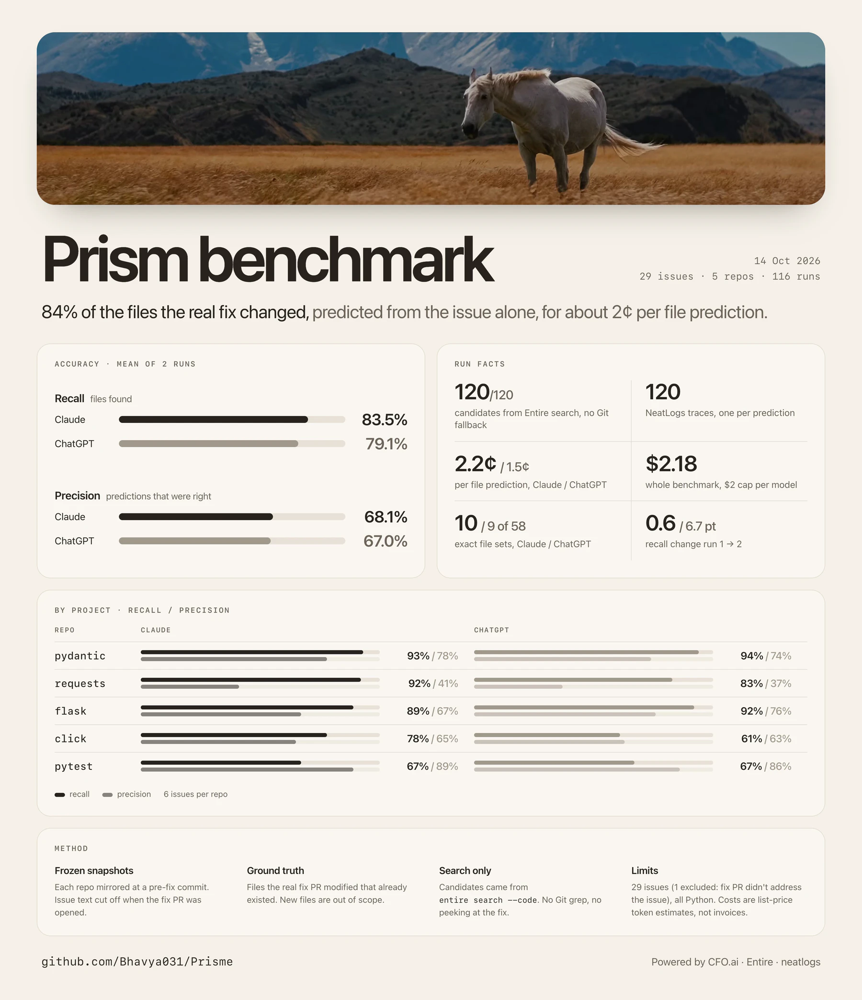

<h1 align="center">Superintelligence needs a budget.</h1>

<strong>On 29 real GitHub issues, Prism found 83% of the files the real fix changed, using Entire search, at about 2 cents of model spend per file prediction.</strong> Claude Sonnet; mean across two repeats per issue.

Powered by

  <a href="https://cfo.ai/"><picture><source media="(prefers-color-scheme: dark)" srcset="docs/assets/logos/cfo-dark.svg"></picture></a>&nbsp;&nbsp;&nbsp;
  <a href="https://entire.io/"><picture><source media="(prefers-color-scheme: dark)" srcset="docs/assets/logos/entire-dark.svg"></picture></a>&nbsp;&nbsp;&nbsp;
  <a href="https://neatlogs.com/"><picture><source media="(prefers-color-scheme: dark)" srcset="docs/assets/logos/neatlogs-dark.svg"></picture></a>

## File prediction, measured

One issue goes in. Prism predicts the existing files a fix will touch. The score compares those predictions with the files changed by the real merged fix.

| | Claude Sonnet | OpenAI GPT-6 Sol |
|---|---:|---:|
| **Recall** | **83.5%** | **79.1%** |
| **Precision** | **68.1%** | **67.0%** |
| **Exact file sets** | **10 / 58** | **9 / 58** |
| **Scored discovery cost** | **$1.26** | **$0.86** |
| **File-finding cost per prediction** | **2.17¢** | **1.48¢** |
| **Total model spend, including excluded case** | **$1.30** | **$0.88** |

Recall and precision are the means of per-issue scores across both repeats. Scored cost and cost per prediction use the 116 included predictions; total model spend includes four predictions from the excluded case. Costs are token-based list-price estimates for file discovery, excluding the rest of Prism's scope, usage, cost, and allocation workflow.

## How it was run

- **5 frozen snapshot repos** in [prism-benchmarks](https://github.com/prism-benchmarks), each fixed at an upstream main-branch commit.
- **29 scored real closed issues** whose fixing PRs merged after their project snapshot; ground truth is the modified files already present in that snapshot.
- **Entire code search only** on the frozen mirror, with no search fallback; 120 / 120 recorded predictions (116 scored) record `discovery.source=entire`.
- **2 repeats × 2 models** for each issue, scored against the same fix.
- **Every recorded run traced in NeatLogs:** 120 unique trace IDs.

## By project

| Frozen snapshot | Issues | Claude recall / precision | OpenAI recall / precision |
|---|---:|---:|---:|
| [flask@ad68a12645d9](https://github.com/prism-benchmarks/flask/tree/ad68a12645d96fe51558da13e18544ba458d7af0) | 5 | 89.3% / 67.1% | 92.1% / 76.3% |
| [requests@70298332899f](https://github.com/prism-benchmarks/requests/tree/70298332899f25826e35e42f8d83425124f755a5) | 6 | 91.7% / 41.2% | 83.3% / 36.9% |
| [click@047adef258fc](https://github.com/prism-benchmarks/click/tree/047adef258fc25566163ffc3efd14effc0ef7352) | 6 | 77.8% / 65.3% | 61.1% / 63.3% |
| [pytest@3b17fa79f8ad](https://github.com/prism-benchmarks/pytest/tree/3b17fa79f8ad28bbda7aa468a750605be9c24553) | 6 | 66.7% / 88.9% | 66.7% / 86.1% |
| [pydantic@f512b087202f](https://github.com/prism-benchmarks/pydantic/tree/f512b087202f58ec90a9d38c9102858567d72440) | 6 | 93.1% / 77.8% | 94.4% / 74.0% |

<strong>All 29 issues and real fixes</strong> — recall by model, repeat 1 / repeat 2

| Issue | Fix PR | Frozen snapshot | Claude recall | OpenAI recall |
|---|---|---|---:|---:|
| [flask #6093](https://github.com/pallets/flask/issues/6093) | [#6096](https://github.com/pallets/flask/pull/6096) | [flask@ad68a12645d9](https://github.com/prism-benchmarks/flask/tree/ad68a12645d96fe51558da13e18544ba458d7af0) | 100% / 100% | 100% / 100% |
| [flask #5961](https://github.com/pallets/flask/issues/5961) | [#5962](https://github.com/pallets/flask/pull/5962) | [flask@ad68a12645d9](https://github.com/prism-benchmarks/flask/tree/ad68a12645d96fe51558da13e18544ba458d7af0) | 100% / 100% | 100% / 100% |
| [flask #5916](https://github.com/pallets/flask/issues/5916) | [#5917](https://github.com/pallets/flask/pull/5917) | [flask@ad68a12645d9](https://github.com/prism-benchmarks/flask/tree/ad68a12645d96fe51558da13e18544ba458d7af0) | 71% / 71% | 86% / 86% |
| [flask #5816](https://github.com/pallets/flask/issues/5816) | [#5899](https://github.com/pallets/flask/pull/5899) | [flask@ad68a12645d9](https://github.com/prism-benchmarks/flask/tree/ad68a12645d96fe51558da13e18544ba458d7af0) | 100% / 100% | 100% / 100% |
| [flask #5895](https://github.com/pallets/flask/issues/5895) | [#5898](https://github.com/pallets/flask/pull/5898) | [flask@ad68a12645d9](https://github.com/prism-benchmarks/flask/tree/ad68a12645d96fe51558da13e18544ba458d7af0) | 75% / 75% | 75% / 75% |
| [requests #7432](https://github.com/psf/requests/issues/7432) | [#7433](https://github.com/psf/requests/pull/7433) | [requests@70298332899f](https://github.com/prism-benchmarks/requests/tree/70298332899f25826e35e42f8d83425124f755a5) | 100% / 100% | 100% / 100% |
| [requests #4795](https://github.com/psf/requests/issues/4795) | [#7427](https://github.com/psf/requests/pull/7427) | [requests@70298332899f](https://github.com/prism-benchmarks/requests/tree/70298332899f25826e35e42f8d83425124f755a5) | 100% / 100% | 100% / 100% |
| [requests #7375](https://github.com/psf/requests/issues/7375) | [#7376](https://github.com/psf/requests/pull/7376) | [requests@70298332899f](https://github.com/prism-benchmarks/requests/tree/70298332899f25826e35e42f8d83425124f755a5) | 100% / 100% | 100% / 100% |
| [requests #6810](https://github.com/psf/requests/issues/6810) | [#7310](https://github.com/psf/requests/pull/7310) | [requests@70298332899f](https://github.com/prism-benchmarks/requests/tree/70298332899f25826e35e42f8d83425124f755a5) | 100% / 100% | 100% / 100% |
| [requests #5436](https://github.com/psf/requests/issues/5436) | [#7244](https://github.com/psf/requests/pull/7244) | [requests@70298332899f](https://github.com/prism-benchmarks/requests/tree/70298332899f25826e35e42f8d83425124f755a5) | 100% / 100% | 0% / 100% |
| [requests #7219](https://github.com/psf/requests/issues/7219) | [#7220](https://github.com/psf/requests/pull/7220) | [requests@70298332899f](https://github.com/prism-benchmarks/requests/tree/70298332899f25826e35e42f8d83425124f755a5) | 50% / 50% | 50% / 50% |
| [click #3802](https://github.com/pallets/click/issues/3802) | [#3818](https://github.com/pallets/click/pull/3818) | [click@047adef258fc](https://github.com/prism-benchmarks/click/tree/047adef258fc25566163ffc3efd14effc0ef7352) | 67% / 67% | 67% / 67% |
| [click #2869](https://github.com/pallets/click/issues/2869) | [#3781](https://github.com/pallets/click/pull/3781) | [click@047adef258fc](https://github.com/prism-benchmarks/click/tree/047adef258fc25566163ffc3efd14effc0ef7352) | 100% / 100% | 100% / 100% |
| [click #2582](https://github.com/pallets/click/issues/2582) | [#3780](https://github.com/pallets/click/pull/3780) | [click@047adef258fc](https://github.com/prism-benchmarks/click/tree/047adef258fc25566163ffc3efd14effc0ef7352) | 0% / 0% | 0% / 0% |
| [click #3571](https://github.com/pallets/click/issues/3571) | [#3769](https://github.com/pallets/click/pull/3769) | [click@047adef258fc](https://github.com/prism-benchmarks/click/tree/047adef258fc25566163ffc3efd14effc0ef7352) | 100% / 100% | 100% / 100% |
| [click #3135](https://github.com/pallets/click/issues/3135) | [#3819](https://github.com/pallets/click/pull/3819) | [click@047adef258fc](https://github.com/prism-benchmarks/click/tree/047adef258fc25566163ffc3efd14effc0ef7352) | 100% / 100% | 50% / 50% |
| [click #1054](https://github.com/pallets/click/issues/1054) | [#3820](https://github.com/pallets/click/pull/3820) | [click@047adef258fc](https://github.com/prism-benchmarks/click/tree/047adef258fc25566163ffc3efd14effc0ef7352) | 100% / 100% | 0% / 100% |
| [pytest #12223](https://github.com/pytest-dev/pytest/issues/12223) | [#15150](https://github.com/pytest-dev/pytest/pull/15150) | [pytest@3b17fa79f8ad](https://github.com/prism-benchmarks/pytest/tree/3b17fa79f8ad28bbda7aa468a750605be9c24553) | 100% / 100% | 100% / 100% |
| [pytest #12175](https://github.com/pytest-dev/pytest/issues/12175) | [#15149](https://github.com/pytest-dev/pytest/pull/15149) | [pytest@3b17fa79f8ad](https://github.com/prism-benchmarks/pytest/tree/3b17fa79f8ad28bbda7aa468a750605be9c24553) | 67% / 67% | 67% / 67% |
| [pytest #6750](https://github.com/pytest-dev/pytest/issues/6750) | [#15058](https://github.com/pytest-dev/pytest/pull/15058) | [pytest@3b17fa79f8ad](https://github.com/prism-benchmarks/pytest/tree/3b17fa79f8ad28bbda7aa468a750605be9c24553) | 67% / 67% | 67% / 67% |
| [pytest #15052](https://github.com/pytest-dev/pytest/issues/15052) | [#15053](https://github.com/pytest-dev/pytest/pull/15053) | [pytest@3b17fa79f8ad](https://github.com/prism-benchmarks/pytest/tree/3b17fa79f8ad28bbda7aa468a750605be9c24553) | 33% / 33% | 33% / 33% |
| [pytest #15043](https://github.com/pytest-dev/pytest/issues/15043) | [#15044](https://github.com/pytest-dev/pytest/pull/15044) | [pytest@3b17fa79f8ad](https://github.com/prism-benchmarks/pytest/tree/3b17fa79f8ad28bbda7aa468a750605be9c24553) | 67% / 67% | 67% / 67% |
| [pytest #11783](https://github.com/pytest-dev/pytest/issues/11783) | [#15040](https://github.com/pytest-dev/pytest/pull/15040) | [pytest@3b17fa79f8ad](https://github.com/prism-benchmarks/pytest/tree/3b17fa79f8ad28bbda7aa468a750605be9c24553) | 67% / 67% | 67% / 67% |
| [pydantic #13971](https://github.com/pydantic/pydantic/issues/13971) | [#13980](https://github.com/pydantic/pydantic/pull/13980) | [pydantic@f512b087202f](https://github.com/prism-benchmarks/pydantic/tree/f512b087202f58ec90a9d38c9102858567d72440) | 100% / 100% | 100% / 100% |
| [pydantic #13976](https://github.com/pydantic/pydantic/issues/13976) | [#13978](https://github.com/pydantic/pydantic/pull/13978) | [pydantic@f512b087202f](https://github.com/prism-benchmarks/pydantic/tree/f512b087202f58ec90a9d38c9102858567d72440) | 100% / 50% | 100% / 100% |
| [pydantic #13965](https://github.com/pydantic/pydantic/issues/13965) | [#13972](https://github.com/pydantic/pydantic/pull/13972) | [pydantic@f512b087202f](https://github.com/prism-benchmarks/pydantic/tree/f512b087202f58ec90a9d38c9102858567d72440) | 100% / 100% | 100% / 100% |
| [pydantic #13919](https://github.com/pydantic/pydantic/issues/13919) | [#13967](https://github.com/pydantic/pydantic/pull/13967) | [pydantic@f512b087202f](https://github.com/prism-benchmarks/pydantic/tree/f512b087202f58ec90a9d38c9102858567d72440) | 100% / 100% | 100% / 100% |
| [pydantic #13957](https://github.com/pydantic/pydantic/issues/13957) | [#13964](https://github.com/pydantic/pydantic/pull/13964) | [pydantic@f512b087202f](https://github.com/prism-benchmarks/pydantic/tree/f512b087202f58ec90a9d38c9102858567d72440) | 100% / 100% | 100% / 100% |
| [pydantic #13950](https://github.com/pydantic/pydantic/issues/13950) | [#13951](https://github.com/pydantic/pydantic/pull/13951) | [pydantic@f512b087202f](https://github.com/prism-benchmarks/pydantic/tree/f512b087202f58ec90a9d38c9102858567d72440) | 67% / 100% | 67% / 67% |

## What this does not establish

- The sample covers five Python projects. It does not establish accuracy across other languages, project sizes, or issue types.
- An agent chose the issues using the stated closed-issue, merged-fix, and existing-file rules. This is a selected sample, not a random draw.
- Flask #3193's four raw predictions remain in the JSON but are excluded from scoring because fix PR #6133 does not address the reported session issue.
- This run has no without-Entire baseline, so it does not measure the effect of switching the search source.
- It measures file prediction, not whether a coding agent would complete the fix. Discovery costs are estimates, not provider invoice totals.

**[Explore the complete results and trace IDs →](data/results/entire-benchmark.json)**
