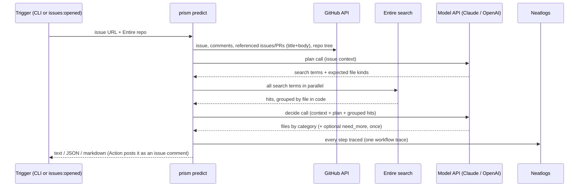
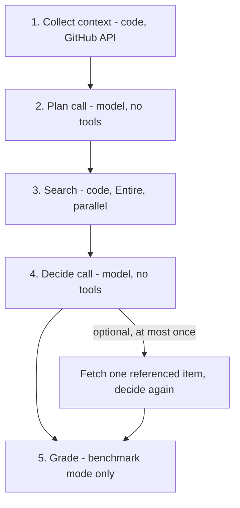
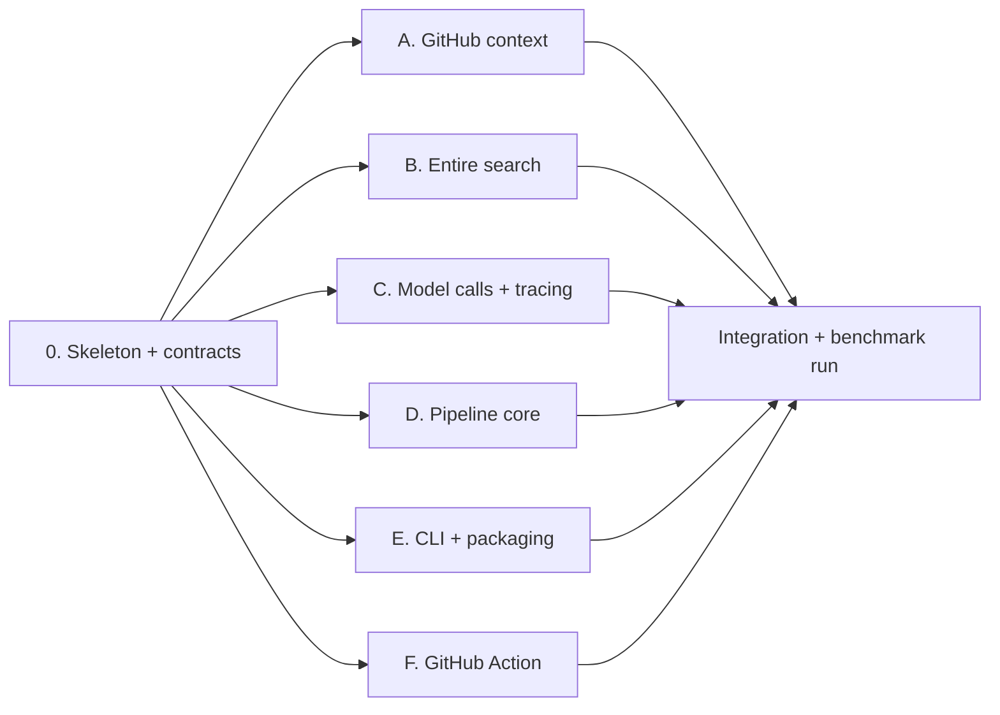

# Prism: handoff brief

You are taking over **Prism**, a hackathon project with a deadline. Read this whole file before writing code. **If anything here is unclear or seems to conflict, stop and ask the user. Do not guess.** The user will pass your questions back to the person who wrote this brief.

## 1. What Prism does

Given a GitHub **issue**, Prism predicts which **existing files** in the repository have to change to fix it. It sorts them into categories (fix, tests, changelog, docs, config), and it does this cheaply, quickly and with full tracing. The name means looking at an issue from several sides: files, token cost and complexity.

Prism has to run in two ways, from one shared core:

1. **CLI:** `prism predict <issue-url>` prints the predicted files. It must be quick to install and quick to start (see section 6).
2. **GitHub workflow:** runs automatically when an issue is opened (`issues: opened`) and posts the prediction as a comment on the issue.

A third command, `prism benchmark`, reruns the 5-case evaluation in section 5 so the scores can be checked against a known answer.

## 1a. System design (decided; don't revisit without asking)

**Decisions and reasons**

| Decision | Reason |
|---|---|
| **Python, distributed with `uv`** (`uvx prism ...`) | Measured: about 1 s of a run is Python startup, and the rest is network and model calls, so another language wouldn't make it noticeably faster. The Neatlogs SDK is Python. With uv, install takes about 1–2 s and the cache is reused after that. |
| **Models through their APIs only** (Anthropic Messages API, OpenAI Responses API) | Works headless in CI, every call is traced, and the cost is predictable. No Claude Code, no Codex CLI, no agent SDK loops. |
| **A fixed pipeline, not an agent loop** | 2 model calls per issue per model (3 at most). Code does the fetching and searching, and models only plan and decide. This raised recall from about 0.5 to about 0.83. |
| **The issue is read first** (the plan step) | The model understands the problem before any search happens, and code then runs its planned searches in parallel. |
| **Context condensed only when needed** | Over about 8k tokens, the plan step also writes an extractive brief. There's no separate summarizer agent unless long threads become common. |
| **Referenced PRs: title and body only** | Keeps cost low. The model can ask for more once (`need_more`). |
| **Entire through the CLI**, with `ENTIRE_TOKEN` in CI | Least work. The HTTP API (section 7) is the fallback, behind `PRISM_ENTIRE_TRANSPORT=http`. |
| **Two modes on one core:** `predict` (live) and `benchmark` (graded) | Benchmark mode only adds the cutoff, target-PR filtering and grading. |

**Runtime flow in predict mode** (CLI and GitHub Action)



**Prerequisites and edge cases in predict mode** (make them explicit in code and error messages):
- The target repository must be **connected to Entire** and show `ready` in `entire repo view gh/<owner>/<repo>`. If it isn't, exit with a clear message saying so. Don't silently return nothing.
- The repo map comes from the repository's **default branch** at run time. There's no cutoff and no target PR.
- If one model fails, still output the other model's result and name the failure. Exit non-zero only if every requested model failed.
- **Issue comment format** (markdown): a heading, then the files grouped by category (fix, tests, changelog, docs, config). Include the model used, the token count and estimated cost, and the Neatlogs trace ID. No raw JSON.
- Expected cost: about $0.02 per model per issue. Default to **one** model in the Action to halve the cost, but ask the user which (section 6, item 5).

## 2. Hard rules (non-negotiable)

1. **No answer leakage in benchmark mode.** The fixing PR's number, URL, title, body, comments, diff and file list must never reach a model before the predictions are finished. That covers:
   - Removing every line that mentions the target PR number. The requests case (issue #6586) has comments that mention the fixing PR #6589.
   - **Time cutoff:** only include comments, referenced issues and referenced PRs created **before the target PR's `created_at`**.
   - Fetching the grading data (the PR's file list) only after both predictions have been submitted.
   - Keeping the existing check that raises an error if the target number appears in any prompt (`safe_prompt` and the check in `bundle_v2`).
2. **No benchmark-specific rules.** Don't add rules written after looking at which files a run missed. For example, an earlier version always added `__main__.py`, `deprecated.py` and docs named `config`/`deprecat`, which matched this benchmark's missed files. Those rules were **removed on purpose**. Rerunning without them gave the **same recall**, so they weren't needed. Only general rules are allowed (section 4, step 3).
3. **Don't use the Codex CLI.** Models are called through the APIs only.
4. **Don't change the benchmark forks** (`Bhavya031/*-premerge-*`) or their Entire mirrors. Read-only access only.
5. **Never commit or print secrets.** `.env.example` lists the variable names. The real `.env` is not included.
6. **Everything must be traced in Neatlogs:** one WORKFLOW trace per issue, with spans for collecting context, the plan call, the searches, the decide call and grading. Record the trace ID in the output.
7. Use the same model settings for every case in a benchmark run.

## 3. What's in this folder

| Path | What it is |
|---|---|
| `HANDOFF.md` | This brief. |
| `reference/entire_compare.py` | **The working implementation.** Read the code from `MANIFEST = ...` (about line 153) to the end: that's the v2 pipeline. The `main()` and `predict_*` functions above it are the older v1 agent loop. Keep them only for comparison or delete them; ask the user if unsure. |
| `reference/issue_surface.py` | Earlier experiment. `entire_compare.py` imports `HEADERS`, `SCHEMA`, `FilePrediction`, `github` and `score` from it. Move what's needed into Prism and drop the rest. |
| `reference/pipeline-design.md` | The design spec the v2 pipeline was built from. **Historical:** where it disagrees with this file or the code, this file and the code win. Its paths point to the old `idea` folder. |
| `data/entire-file-finding-manifest.json` | The 5 benchmark cases: issue URL, PR URL, fork, pre-merge SHA and true modified files. |
| `data/results/v1-agent-loop.json` | Baseline results from the v1 agent loop. |
| `data/results/v2-pipeline.json` | Current results from the v2 pipeline (section 5). |
| `.env.example` | The environment variables Prism needs. |

The code currently hardcodes the manifest path as `/Users/bhavya/.ao/data/artifacts/idea-2/...`. Point it at `data/entire-file-finding-manifest.json` in the new project.

## 4. How the v2 pipeline works (already built and tested)

Each model (Claude and OpenAI) runs the whole pipeline on its own, and the two run in parallel. Each issue takes **2 model calls per model**, or 3 if the optional "need more" call is used.



1. **Collect context** (`bundle_v2`): the issue title, body and comments before the cutoff. References found in the text (`#123`, URLs, `owner/repo#123`) are followed one level deep: referenced issues include their body and comments, referenced PRs include **only title and body plus a one-line pointer** (number of comments and files), never a diff. File paths mentioned in the text become hints. A repository map comes from the pre-merge tree, with top-level entries, directories, conventional files and test/doc folders. GitHub responses are cached in `~/.cache/entire-file-finding-v2`.
2. **Plan** (`pipeline_v2` → `model_call_v2(..., "plan")`): returns `problem`, `suspected_cause`, 6–10 `search_terms` and `expected_file_kinds`. If the context is over about 8k tokens, it also returns an extractive `brief` (exact quotes, identifiers, paths), and the decide step uses that in place of the full context. That threshold never triggered on the 5 cases.
3. **Search** (`grouped_v2`): runs every term through Entire code search in parallel (`--limit 30`) and groups hits by file (hit count, matching terms, 2 lines each). It adds **general** candidates only: path hints, paths named in the plan, `pyproject.toml`/`setup.cfg`, a top-level `CHANGES*`/`CHANGELOG*`, and test files named after the source files that matched. The list is capped at 40 files.
4. **Decide**: returns a category schema `{fix, tests, changelog, docs, config, need_more}`. Paths not in the pre-merge tree are dropped and recorded. `need_more` can ask once for `"#N comments"` or `"#N files"` of a reference that's allowed (from before the cutoff and not the target).
5. **Grade** (`truth_v2`): only after both predictions are in. Compares against the PR's modified existing files.

**Models:** Claude `claude-sonnet-5-5` through the Anthropic Messages API, and OpenAI `gpt-6-sol` through the Responses API. Both use **medium** effort, `max_tokens` 4000 and JSON-schema structured output.

**Commands today** (run from the folder containing the script):

```bash
uv run --python 3.13 --with neatlogs --with claude-agent-sdk --with openai-agents --with anthropic entire_compare.py --v2-dry-run   # free: prints model context, checks for leaks
uv run ... entire_compare.py --v2-one   # pytest case only, about $0.04
uv run ... entire_compare.py --v2       # all 5 cases, about $0.18
```

## 5. Current results (rerun after removing the benchmark-specific rules)

| | Mean recall | Mean precision | Exact matches | Model calls | Estimated cost (5 cases) |
|---|---|---|---|---|---|
| Claude, v1 agent loop (baseline) | 0.44 | 0.90 | 0 | – | $0.059 (recorded by the SDK) |
| OpenAI, v1 agent loop (baseline) | 0.54 | 0.83 | 1 | – | $0.045 (estimated) |
| **Claude, v2 pipeline** | **0.82** | 0.74 | 2 | 10 | $0.109 (estimated) |
| **OpenAI, v2 pipeline** | **0.85** | 0.72 | 2 | 10 | $0.071 (estimated) |

- **Recall** is the share of truly changed files the model found. **Precision** is the share of predicted files that were correct. The target was recall ≥ 0.75, which v2 meets. About 0.75 precision is acceptable, because an extra file is cheap and a missed one isn't.
- v2 costs about **twice as much** as v1 (about $0.02 per model per issue) and runs in 9–17 s per issue.
- v2 costs are **estimates** from list prices. The price table is in `PRICES` and in the results file. No provider-recorded cost is captured for v2.
- **Still missed by both models:** pytest #1764 (`doc/en/conf.py`, `doc/en/deprecations.rst`, `pyproject.toml`, `src/_pytest/deprecated.py`, `src/pytest/__main__.py`) and flask #5916 (`tests/test_cli.py`, and for Claude also `tests/test_blueprints.py`). Don't fix these with rules aimed at these files (rule 2).
- Neatlogs trace IDs for every case are in `data/results/v2-pipeline.json`.

## 6. What to build next (in this order)

The hackathon ends in about 40 hours. Don't add features beyond this list without asking.

1. **Restructure into a Python package called `prism`**, with these commands:
   - `prism predict <issue-url> [--repo <entire-repo>]` for live use: the repo's current default branch, **no** target PR, **no** cutoff, no grading.
   - `prism benchmark [--one]` for the 5 cases in `data/` with the full leak rules. It writes a results file.
   - `prism dry-run` for the free context and leak check.
   - Keep one shared core (context, plan, search, decide), and use benchmark mode only to add the cutoff, target filtering and grading.
2. **Make dependencies lighter:** v2 only needs `anthropic`, `openai` and `neatlogs`. Drop `claude-agent-sdk` and `openai-agents` (needed only by v1 and `issue_surface.py`) so installs and startup are quick.
3. **Package it for `uv`:** `pyproject.toml` with a `prism` console script, so `uvx prism ...` and `uv tool install prism` work.
4. **GitHub Action:** `on: issues: types: [opened]`. Steps: `astral-sh/setup-uv`, install the Entire CLI, then `uvx prism predict ${{ github.event.issue.html_url }}`, then post the output as an issue comment. Secrets: `ANTHROPIC_API_KEY`, `OPENAI_API_KEY`, `NEATLOGS_API_KEY`, `ENTIRE_TOKEN`, plus the workflow's built-in `GITHUB_TOKEN`.
5. **Ask the user before choosing:** whether `predict` runs both models or one by default, and if one, which.

## 7. Facts already checked (use them; don't re-research)

- **Entire CLI in CI:** `entire login` needs a browser, but setting **`ENTIRE_TOKEN`** (the value from `entire auth token`) authenticates `entire search` without a login. This was tested with an empty home directory. The token is the user's **personal** token and its lifetime is **unknown**, so test it in a real workflow early and again later.
- **Entire install in CI:** the binary references `https://entire.io/install.sh`. **Not tested on Linux.** Check Entire's install docs and make sure the binary is on `PATH`.
- **Entire HTTP API (fallback if the CLI is a problem):** these are **internal endpoints that may change without notice**.
  - `GET https://us.console.entire.io/api/v1/repos` with `Authorization: Bearer <ENTIRE_TOKEN>` lists repos with their IDs (ULIDs) and `cell`.
  - `GET https://aws-us-east-2.api.entire.io/api/v1/search/api/search?q=<term>&max_results=30&repo=<ULID>` does code search. It **only accepts ULIDs**, not names. Build the host from the repo's `cell`. It took about 0.9 s round trip in testing.
- **Neatlogs:** `neatlogs.wrap(anthropic.AsyncAnthropic())` and `neatlogs.wrap(AsyncOpenAI())` trace LLM calls. `@neatlogs.span(kind="TOOL")` records a failure status when the function raises. `with neatlogs.trace(...)` does **not** mark the span as failed when an exception happens. Reading traces back needs `NEATLOGS_TOKEN` and `NEATLOGS_PROJECT_ID`, which we don't have.
- **Speed:** almost all the time is network and model calls. Python startup is about 1 s, so there's no reason to change language.

## 8. Known issues in the current code

- After each run, stderr shows a harmless `RuntimeError: Event loop is closed` from an HTTP client being closed after `asyncio.run` ends. Results are unaffected. Fix it by creating the Anthropic and OpenAI clients once per event loop and closing them before the loop ends.
- `model_call_v2` wraps each auto-traced LLM call in another `neatlogs.trace(..., kind="LLM")` span. Check in Neatlogs whether tokens are counted twice. If they are, change the outer span to `CHAIN`.
- `load_env_v2` falls back to `gh auth token` when `GITHUB_TOKEN` isn't set. That's fine locally and in Actions, but handle a missing `gh` cleanly.
- The `MANIFEST` path is hardcoded (section 3).

## 9. Work that can run in parallel

Most of the logic already exists in `reference/entire_compare.py`. The work is mostly moving it into modules and wiring it up, so it splits cleanly. **First, one agent creates the package skeleton with the contracts below** (signatures, data shapes, stub functions that raise `NotImplementedError`). That takes about 30 minutes. Then workstreams A–F run at the same time, each touching only its own files, and an integration step closes it out.



### Package layout and contracts (created in step 0)

```
pyproject.toml            # E owns
src/prism/
  __init__.py
  types.py                # step 0 owns; frozen after step 0
  github_context.py       # A owns
  entire.py               # B owns
  models.py               # C owns
  tracing.py              # C owns
  pipeline.py             # D owns
  benchmark.py            # D owns
  cli.py                  # E owns
  data/                   # packaged copy of the default manifest
tests/
data/                     # manifests + results
.github/workflows/prism.yml   # F owns
```

`types.py` (plain dataclasses, no logic):

```python
@dataclass
class Bundle:            # what the models see; must never contain the target PR in benchmark mode
    issue: dict          # {"title", "body", "comments": [str]}
    references: list[dict]   # [{"reference", "type": "PR"|"issue", "title", "body", "pointer"?, "comments"?}]
    path_hints: list[str]
    repo_map: dict       # {"top_level", "directories", "conventional_files", "test_directories", "doc_directories", "file_count"}

@dataclass
class Context:
    bundle: Bundle
    known_paths: set[str]        # every file in the tree being predicted against
    safe_refs: set[tuple[str, str, int]]
    cutoff: str | None           # ISO time; None in predict mode
    target_pr: int | None        # None in predict mode
    entire_repo: str             # e.g. "gh/Bhavya031/flask-premerge-5917"

@dataclass
class Hit:
    path: str
    line: int
    text: str

@dataclass
class Usage:
    input: int; output: int; cached_input: int; cache_write: int; reasoning: int | None

@dataclass
class Prediction:
    provider: str                # "claude" | "openai"
    by_category: dict[str, list[str]]   # keys: fix, tests, changelog, docs, config
    predicted: list[str]
    dropped_nonexistent: list[str]
    model_calls: int
    need_more_used: bool
    condensed: bool
    usage: Usage
    estimated_cost_usd: float
```

Function contracts:

| Module | Function | Behavior (port from `entire_compare.py`) |
|---|---|---|
| `github_context.py` (A) | `build_context(issue_url: str, *, entire_repo: str, pr_url: str \| None = None, pre_merge_sha: str \| None = None) -> Context` | `bundle_v2`, `comments_v2`, `clean_v2`, `refs_v2`, `repo_map_v2`, `api_v2`. With `pr_url`, this is benchmark mode: cutoff, target filtering and the leak check that raises. Without it, this is predict mode: the tree is the repo's default branch, with no cutoff. |
| `github_context.py` (A) | `fetch_reference(request: str, ctx: Context) -> dict \| None` | `extra_reference_v2` |
| `github_context.py` (A) | `true_files(pr_url: str, known_paths: set[str]) -> set[str]` | `truth_v2` |
| `entire.py` (B) | `search(term: str, repo: str, limit: int = 30) -> list[Hit]` | CLI first (`entire search --code ... --json`). If `PRISM_ENTIRE_TRANSPORT=http`, use the HTTP API from section 7 (repo ULID lookup, cell host, cache the ULID). |
| `entire.py` (B) | `search_many(terms: list[str], repo: str) -> dict[str, list[Hit]]` | Runs the searches in parallel. |
| `models.py` (C) | `async call(provider: str, stage: str, prompt: str, schema: dict) -> tuple[dict, Usage]` | `model_call_v2`. Create clients once per event loop and close them, which fixes the "Event loop is closed" message. Use `claude-sonnet-5-5` and `gpt-6-sol`, medium effort, 4000 max tokens. Models can be overridden with `PRISM_CLAUDE_MODEL` and `PRISM_OPENAI_MODEL`. |
| `models.py` (C) | `estimate_cost(provider: str, usage: Usage) -> float` | `estimate_v2` and `PRICES`. Claude cache reads are $0.10/M. |
| `tracing.py` (C) | `init()`, `workflow(name)`, `step(name, kind)`, `shutdown()` | Thin wrappers over `neatlogs.init`, `neatlogs.trace` and `neatlogs.span`. If `NEATLOGS_API_KEY` is missing, they do nothing. A step must record an error status when its code raises. |
| `pipeline.py` (D) | `async predict(ctx: Context, provider: str) -> Prediction` | `pipeline_v2` and `grouped_v2`, including the `safe_prompt` leak guard and the general candidate rules only. |
| `benchmark.py` (D) | `run(manifest: Path, *, one: bool, dry_run: bool) -> dict` | `case_v2` and `v2_main`. Writes results and also appends rows in the `runs.json` schema of the benchmark export (see section 11). |
| `cli.py` (E) | `prism predict <issue-url> --repo <entire-repo> [--provider claude\|openai\|both] [--format text\|json\|markdown]`, `prism benchmark [--one]`, `prism dry-run` | Argument parsing only. Calls A–D. Markdown output is what F posts as an issue comment. |
| `.github/workflows/prism.yml` (F) | Runs on `issues: opened` | setup-uv, install the Entire CLI, `uvx --from . prism predict ${{ github.event.issue.html_url }} --repo gh/${{ github.repository }} --format markdown`, then post a comment with `gh issue comment`. Secrets as in section 6. |

### Workstreams

| ID | Owns | Can start after | Done when |
|---|---|---|---|
| 0 | skeleton, `types.py`, stubs | – | The package imports, `prism --help` runs, all stubs exist |
| A | `github_context.py` | 0 | Dry-run context for all 5 manifest cases matches the old `--v2-dry-run` output, and the target PR numbers are absent |
| B | `entire.py` | 0 | `search("Retry", "gh/Bhavya031/urllib3-premerge-4960")` returns hits through both the CLI and HTTP transports |
| C | `models.py`, `tracing.py` | 0 | One tiny real call per provider returns parsed JSON and a `Usage` (costs a fraction of a cent; ask the user first), with a trace visible in Neatlogs |
| D | `pipeline.py`, `benchmark.py` | 0 (stubs A–C with fakes) | It runs end to end on fakes. After integration, `prism benchmark --one` reproduces the pytest results (recall 0.38 for both models) |
| E | `pyproject.toml`, `cli.py` | 0 | `uvx --from . prism --help` works in a clean environment, and startup is under about 1.5 s |
| F | `.github/workflows/prism.yml` | 0 | The workflow passes `actionlint`. A test run in a sandbox repo is done with the user, since it needs secrets |
| I (integration) | wiring and fixes only | A–F | `prism dry-run` is clean, `prism benchmark --one` matches, and the user approves a full `prism benchmark` |

Rules for parallel agents: each agent edits **only the files it owns**. If it needs a contract change, it asks (through the user) instead of editing `types.py`. No paid model calls except C's smoke test and the integration runs, and only with the user's approval.

## 10. How to work with the user

- Credits are limited. Run `prism dry-run` (free) before any paid run, run `--one` before the full benchmark, and say what a run will cost before starting it.
- Report results with recall, precision, exact matches, tokens, cost (keep recorded and estimated cost apart) and Neatlogs trace IDs.
- **If you need a decision, are missing a fact, or something contradicts this brief, ask the user rather than assuming.**

## 11. Benchmark data and showcase

All results so far are exported in **`~/Downloads/prism-benchmark/`**, with its own `BENCHMARK_BRIEF.md`. It covers the dataset schema (`data/runs.json`), the story from stage s0 to s3, how to prove results, the protocol for adding the 10 new repos, and dashboard guidance. `prism benchmark` must write rows in that same `runs.json` schema, with a new `stage` value per run, so new results join the existing dataset without conversion.
