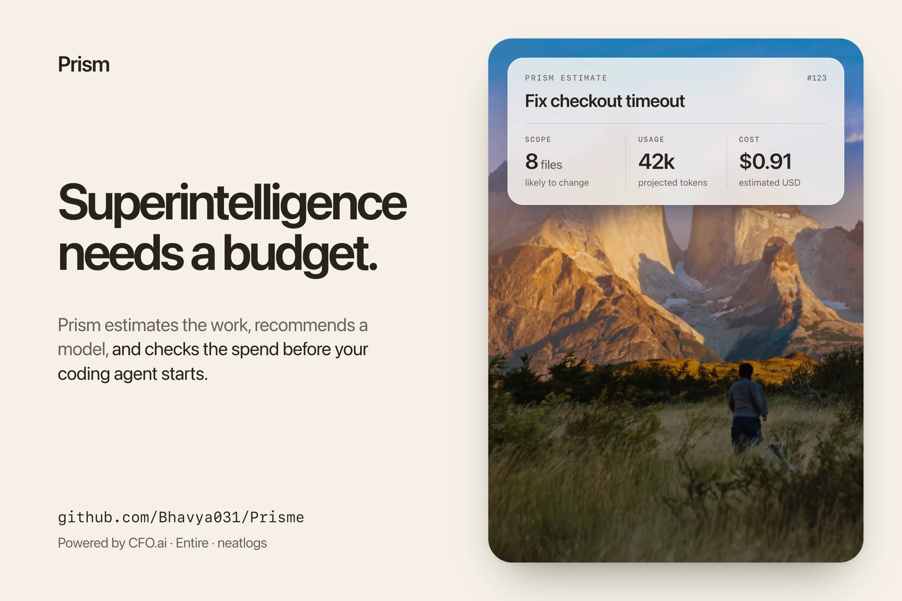

<h1 align="center">Prism</h1>
<p align="center">Powered by</p>
<p align="center">
  <a href="https://cfo.ai/"><picture><source media="(prefers-color-scheme: dark)" srcset="docs/assets/logos/cfo-dark.svg"></picture></a>&nbsp;&nbsp;&nbsp;
  <a href="https://entire.io/"><picture><source media="(prefers-color-scheme: dark)" srcset="docs/assets/logos/entire-dark.svg"></picture></a>&nbsp;&nbsp;&nbsp;
  <a href="https://neatlogs.com/"><picture><source media="(prefers-color-scheme: dark)" srcset="docs/assets/logos/neatlogs-dark.svg"></picture></a>
</p>



## Try it yourself

Judges: [open a Flask issue](https://github.com/Bhavya031/flask/issues/new) with any title and body below; Prism replies with predicted files, tokens, USD cost, then a CFO.ai allocation in about 3 minutes. After editing, comment `/prism estimate` to re-run.

### Issue 1

**Title**

```text
Warn at startup when SECRET_KEY is missing and sessions are used
```

**Body**

```text
When `SECRET_KEY` is not set, using `session` fails only when a request tries to write to it, with "The session is unavailable because no secret key was set". This is easy to miss in development until a specific page is hit.

Flask could log a clear warning once at app startup (or on the first request) when sessions are used and `SECRET_KEY` is empty, pointing to the config docs.

Expected: a one-time warning that names `SECRET_KEY` and links to the docs. No behaviour change otherwise.
```

### Issue 2

**Title**

```text
Add --json output to flask routes
```

**Body**

```text
`flask routes` prints a table that is easy to read but hard to use from scripts.

Please add a `--json` option that prints each rule as a JSON object with `endpoint`, `methods` and `rule`, keeping the current sorting options (`--sort`, `--all-methods`). The table output stays the default.

This would help tools that check route coverage or generate API docs.
```

### Issue 3

**Title**

```text
Validate blueprint url_prefix starts with a slash
```

**Body**

```text
Registering a blueprint with a `url_prefix` that has no leading slash, for example `app.register_blueprint(bp, url_prefix="api")`, produces routes that do not match what the user expects, and the mistake is silent.

Flask should either add the missing leading slash or raise a clear `ValueError` explaining that `url_prefix` must start with `/`.

Please also add a test and a note in the blueprints docs.
```

A prism splits one beam into its parts. **Prism** takes one GitHub issue and shows three sides before a coding worker starts: **scope** (the existing files likely to change), **usage** (predicted tokens), and **cost** (a USD estimate followed by a budget-rule allocation). It provides automated estimation and allocation; it does not implement the issue.

## Install

Install the CLI once, then start guided setup:

```sh
uv tool install git+https://github.com/Bhavya031/Prisme.git
prism init
```

Or run without installing: `uvx --from git+https://github.com/Bhavya031/Prisme.git prism init`. Choose **This computer**, **GitHub repository**, or **Both**. Run `prism check --repo OWNER/NAME` for the setup-check table; it makes no model completion, CFO.ai request, or secret write. [SETUP.md](docs/SETUP.md) has the full prerequisites.

| Setup-check row | Checks |
|---|---|
| Config; OpenAI or Anthropic | Settings, provider key, and worker-model price |
| Entire | Token and repository mirror readiness |
| CFO.ai; GitHub | Table settings, sign-in metadata, and shared repository secret access |
| NeatLogs; Glance | Optional tracing key and local token counter |

`BLOCK` needs action; `WARN` could not be fully verified; `MISSING` can mean an optional item is absent.

## Results

In a benchmark of 15 real open-source issues, Claude Sonnet found 73% of fix files on average (71% precision; 5 of 15 exact file sets). OpenAI GPT-6 Sol found 83% (62% precision; 3 of 15 exact). Estimated file-discovery cost was about $0.71 total for 60 model calls. It measures file prediction only, not cost-estimate accuracy or completed fixes.

In an earlier 5-issue run using Entire code search on indexed mirrors, Claude Sonnet found 82% of fix files (74% precision) and OpenAI GPT-6 Sol found 85% (72% precision); results are in [data/results/v2-pipeline.json](data/results/v2-pipeline.json).

## Evidence: real runs

Each issue below has both Prism comments: the estimate with predicted files and the budget allocation.

| Repo | Issue |
|---|---|
| Bhavya031/flask | [#5 Raise error when blueprint name contains a dot](https://github.com/Bhavya031/flask/issues/5) |
| Bhavya031/werkzeug | [#5 ProxyFix should not set SERVER_NAME or SERVER_PORT](https://github.com/Bhavya031/werkzeug/issues/5) |
| Bhavya031/markupsafe | [#1 escape() fails with certain str subclasses](https://github.com/Bhavya031/markupsafe/issues/1) |
| Bhavya031/itsdangerous | [#1 URLSafeSerializer.dumps may return bytes](https://github.com/Bhavya031/itsdangerous/issues/1) |
| Bhavya031/quart | [#1 App appends :5000 to the name of a socket file](https://github.com/Bhavya031/quart/issues/1) |
| Bhavya031/k-2 | [#48 Trim surrounding whitespace in offline report search](https://github.com/Bhavya031/k-2/issues/48) |
| Bhavya031/k-2 | [#47 Show document page numbers on offline report exceptions](https://github.com/Bhavya031/k-2/issues/47) |

[Live CFO.ai budget dashboard](https://cfo.ai/s/7nP1l9E8l6ebolGG)

The open-source forks already contain the upstream fixes, so these show the workflow end to end; the accuracy numbers come from the 15-issue benchmark above.

## Set up the workflow on your repo

Enable **Issues** in repository Settings and **Actions** in the Actions tab before testing, especially on a fork where workflows do not run by default. Allow the workflow's `issues: write`, `contents: read`, and `actions: read` permissions. Register and index the same repo in Entire until `/gh/OWNER/NAME` is ready ([steps](docs/SETUP.md#how-to-get-entire)). Add these two files to your repo's `.github/workflows/` and commit them to its default branch. These are the complete [example callers](examples/); their jobs use Prisme's reusable workflows at `@main`.

`.github/workflows/prism-estimate.yml`:

```yaml
name: Prism automated estimation and allocation

on:
  issues:
    types: [opened]
  issue_comment:
    types: [created]

permissions:
  actions: read
  contents: read
  issues: write

jobs:
  prism:
    uses: Bhavya031/Prisme/.github/workflows/prism-estimate.yml@main
    with:
      prisme_ref: main
    secrets:
      ANTHROPIC_API_KEY: ${{ secrets.ANTHROPIC_API_KEY }}
      OPENAI_API_KEY: ${{ secrets.OPENAI_API_KEY }}
      NEATLOGS_API_KEY: ${{ secrets.NEATLOGS_API_KEY }}
      ENTIRE_TOKEN: ${{ secrets.ENTIRE_TOKEN }}
      PRISME_READ_TOKEN: ${{ secrets.PRISME_READ_TOKEN }}
      CFO_OAUTH_CLIENT_ID: ${{ secrets.CFO_OAUTH_CLIENT_ID }}
      CFO_OAUTH_REFRESH_TOKEN: ${{ secrets.CFO_OAUTH_REFRESH_TOKEN }}
      CFO_SECRET_WRITE_TOKEN: ${{ secrets.CFO_SECRET_WRITE_TOKEN }}
```

`.github/workflows/prism-cfo-allocation.yml`:

```yaml
name: Prism automated estimation and allocation validation

on:
  workflow_dispatch:
    inputs:
      run_id:
        description: Saved Prism estimate run in this repository
        required: true
      issue_number:
        description: Issue the saved estimate belongs to
        required: true
      preflight_only:
        description: Check GitHub secret write access without CFO OAuth
        type: boolean
        default: false

permissions:
  actions: read
  contents: read
  issues: write

jobs:
  prism:
    uses: Bhavya031/Prisme/.github/workflows/prism-cfo-allocation.yml@main
    with:
      prisme_ref: main
      run_id: ${{ inputs.run_id }}
      issue_number: ${{ inputs.issue_number }}
      preflight_only: ${{ inputs.preflight_only }}
    secrets:
      PRISME_READ_TOKEN: ${{ secrets.PRISME_READ_TOKEN }}
      CFO_OAUTH_CLIENT_ID: ${{ secrets.CFO_OAUTH_CLIENT_ID }}
      CFO_OAUTH_REFRESH_TOKEN: ${{ secrets.CFO_OAUTH_REFRESH_TOKEN }}
      CFO_SECRET_WRITE_TOKEN: ${{ secrets.CFO_SECRET_WRITE_TOKEN }}
```

Add repository secrets under **Settings → Secrets and variables → Actions → Repository secrets**:

| Secret | Needed when |
|---|---|
| `OPENAI_API_KEY` or `ANTHROPIC_API_KEY` | Required for the provider selected by `estimate.provider`; only that provider's key is needed. |
| `ENTIRE_TOKEN` | Required for live issue search. |
| `CFO_OAUTH_CLIENT_ID`, `CFO_OAUTH_REFRESH_TOKEN` | Required for allocation; `prism cfo-login` saves them. |
| `CFO_SECRET_WRITE_TOKEN` | Required for allocation; needs Secrets read/write access to every repo sharing the CFO.ai login. |
| `NEATLOGS_API_KEY` | Optional tracing. |
| `PRISME_READ_TOKEN` | Only while Prisme is private. |

GitHub supplies `GITHUB_TOKEN`; do not add it as a secret. An owner, member, or collaborator triggers a run by opening an issue or posting exactly `/prism estimate` on an issue. Successful estimates start allocation automatically. Requests have a repository-wide cooldown (`estimate.cooldown_minutes`, default 10; the shared portfolio config uses 2). The same issue title and body at the same source commit are not estimated twice. The second caller manually validates a saved estimate, or just secret-write access with `preflight_only`; it does not run on every issue.

## Point the workflow at your settings

The `uses: ...@main` line selects the reusable workflow; `prisme_ref: main` selects Prisme code and shared config. Keep those refs equal in **both** callers. Choose one config source:

- **Your repo:** Leave out `config:`. Commit [examples/prism.json](examples/prism.json) as `.github/prism.json` on your repo's default branch and edit its values.
- **Shared in Prisme:** Add `config: configs/portfolio.json` under `with:`, immediately after `prisme_ref: main`, in **both** callers. The [portfolio config](configs/portfolio.json) selects OpenAI, `gpt-6-sol`, and a shared CFO.ai login list. Confirm its page and table names in CFO.ai before allocation.

The JSON settings file has these fields:

| Group | Fields |
|---|---|
| `cfo` | `org_id`, `scenario`, `page`, `budget_table`, `request_table`, `decision_table`, `column_prefix`; optional `shared_login_repos` lists every `OWNER/NAME` receiving the rotating login. |
| `estimate` | `provider` (`openai` or `claude`), `worker_model`, `max_cost_usd`, `max_output_tokens`, `max_extra_rounds`, `timeout_seconds`, `cooldown_minutes`. |

CFO.ai pages, tables, and the saved budget rule need manual setup; use the exact names in [SETUP.md](docs/SETUP.md#cfoai-page-and-tables). For a historical replay, set the optional Actions variable `PRISM_REPLAY_REF`; live issues otherwise use the default branch.

## CFO.ai sign-in

```sh
prism cfo-login --repo OWNER/NAME
```

Approve the browser sign-in. Repeat `--repo OWNER/NAME` in the same command for every repository in `cfo.shared_login_repos`. They share one rotating refresh token, so run allocations in one repository at a time; workflow concurrency covers only one repository. The observed Entire login token lasted eight hours. When `ENTIRE_TOKEN` expires, refresh the Actions secret before another run:

```sh
entire login
entire auth token | gh secret set ENTIRE_TOKEN --repo OWNER/NAME
```

Use the Entire region containing the ready mirror. If the repo uses the shared portfolio config, refresh `ENTIRE_TOKEN` in each target repo that runs estimates.

## Works today / Not built yet

- **Works today:** issue-triggered file prediction with OpenAI or Claude, a heuristic token and USD estimate, issue comments, and budget-rule allocation with a reservation for approved requests.
- **Not built yet:** a solve worker, actual-spend report-back and reconciliation, and calibration of cost projections against a real coding run. Live issues need a ready Entire mirror.

## What it is

Prism is a Python CLI with example GitHub Actions workflows. An eligible issue or `/prism estimate` comment starts a file prediction, a heuristic estimate of a future coding run, and then an allocation check using the budget rule saved in CFO.ai. Scope and usage are predictions, not a plan or a bill. The estimate labels its assumptions as unvalidated.

## How it works



1. The example workflow reacts to new issues and exact `/prism estimate` comments from repository owners, members, or collaborators. A separate job adds 👀. The estimate job pins the default branch commit (or a maintainer-set replay ref), then checks duplicate requests and a repository-wide cooldown before model calls.
2. **Scope:** a model searches the ready Entire mirror for a live issue and predicts existing file paths. Prism reads selected file contents from that commit.
3. **Usage:** Glance counts the issue text and selected file contents as a starting context. Prism applies explicit, unvalidated assumptions to project low, central, and high token usage for a future worker run.
4. **Cost:** Prism prices those projections with model list prices and adds the file-discovery call's known cost. It posts the estimate first. On success, it writes predicted-token inputs to CFO.ai's decision test table, reads the saved budget rule's result, and sanity-checks the allow/block decision, chosen model, allocated amount, and reason. It writes a reservation for a new approved request and posts a separate result. If that request ID already has a reservation row, it uses the existing record without a second reservation.

## Integrations

| Integration | Role today |
|---|---|
| [Entire](https://entire.io/) | Provides the searchable mirror that names candidate files for live issues; Prism reads their contents from the pinned Git commit. |
| [Anthropic](https://www.anthropic.com/) and [OpenAI](https://openai.com/) | Claude or OpenAI predicts likely files. Select one with `estimate.provider`; the shared portfolio config selects OpenAI. |
| [Glance](https://github.com/Bhavya031/Glance) | Counts the exact starting context bytes that Prism assembles; it does not pick files or estimate the whole worker run. Built by us during the hackathon on 2026-10-10 alongside Prism, it ships [prebuilt binaries](https://github.com/Bhavya031/Glance/releases/latest) for macOS, Linux, and Windows (amd64 and arm64). |
| [Neatlogs](https://neatlogs.com/) | Optional tracing for Prism's model workflow when `NEATLOGS_API_KEY` is set. It does not determine scope, usage, cost, or allocation. |
| [CFO.ai](https://cfo.ai/) | Holds the saved budget rule and its decision test, budget, and request tables. Prism reads the rule's result, checks it, and records approved reservations through CFO.ai model tools. [Live CFO.ai budget dashboard](https://cfo.ai/s/7nP1l9E8l6ebolGG). |

## What appears on the issue

- **Estimate comment:** one marked comment is first reserved as “Estimating,” then updated with predicted files (**scope**), measured starting context and low/central/high projected tokens (**usage**), solve and end-to-end USD estimates (**cost**), discovery spend, worker model, and pinned commit. A failure updates it with the stopping reason when possible.
- **Allocation comment:** on a successful estimate, a separate comment mentions the requester, repeats the predicted files, and shows the budget, spending, reservations, allocated amount, remaining balance, and request limit. It shows the saved budget rule's chosen model and reason, three suggested models, and other models in a fold-out. A blocked result has no new reservation. When the request ID already has a reservation row, the comment says it was already recorded and no second reservation was added.

## CFO.ai data boundary

Prism writes the repository name, issue URL, and projected **uncached input, cached input, and output tokens** to the configured decision test table. The saved budget rule supplies the allow/block decision, chosen model, allocated USD amount, reason, and model suggestions. Prism reads the computed decision row, checks the inputs and approved amount against available funds and the request limit, then writes the pinned commit, chosen model, token counts, amount, and reason to the reservation table for a new approved request. It reads the reservation back to confirm it. **Prism prices its own estimate before this step; it sends no price list, repository code, or issue text in these CFO.ai calls.** The issue URL is included.
