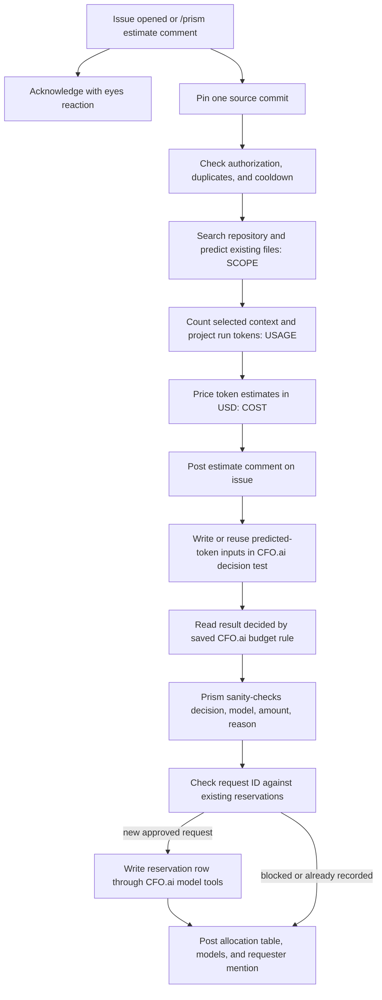

# Prism

A prism splits one beam into its parts. **Prism** takes one GitHub issue and shows three sides before a coding worker starts: **scope** (the existing files likely to change), **usage** (predicted tokens), and **cost** (a USD estimate followed by a budget-rule allocation). It provides automated estimation and allocation; it does not implement the issue.

## What it is

Prism is a Python CLI with example GitHub Actions workflows. An eligible issue or `/prism estimate` comment starts a file prediction, a heuristic estimate of a future coding run, and then an allocation check using the budget rule saved in CFO.ai. Scope and usage are predictions, not a plan or a bill. The estimate labels its assumptions as unvalidated.

## How it works

1. The example workflow reacts to new issues and exact `/prism estimate` comments from repository owners, members, or collaborators. A separate job adds 👀. The estimate job pins the default branch commit (or a maintainer-set replay ref), then checks duplicate requests and a repository-wide cooldown before model calls.
2. **Scope:** a model searches the ready Entire mirror for a live issue and predicts existing file paths. A replay searches Git at the pinned commit. Prism reads selected file contents from that commit.
3. **Usage:** Glance counts the issue text and selected file contents as a starting context. Prism applies explicit, unvalidated assumptions to project low, central, and high token usage for a future worker run.
4. **Cost:** Prism prices those projections with model list prices and adds the file-discovery call's known cost. It posts the estimate first. On success, it writes predicted-token inputs to CFO.ai's decision test table, reads the result decided by the budget rule saved there, and sanity-checks the allow/block decision, chosen model, allocated amount, and reason. It writes a reservation for a new approved request and posts a separate result. If that request ID already has a reservation row, it uses the existing record without a second reservation.

## Integrations

| Integration | Role today |
|---|---|
| [Entire](https://entire.io/) | Provides the searchable mirror that names candidate files for live issues; Prism reads their contents from the pinned Git commit. |
| [Anthropic](https://www.anthropic.com/) | The example's Claude provider predicts likely files from issue and repository context. Prism also supports an OpenAI provider, but the example config selects Claude. |
| [Glance](https://github.com/Bhavya031/Glance) | Counts the exact starting context bytes that Prism assembles; it does not pick files or estimate the whole worker run. |
| [Neatlogs](https://neatlogs.com/) | Optional tracing for Prism's model workflow when `NEATLOGS_API_KEY` is set. It does not determine scope, usage, cost, or allocation. |
| [CFO.ai](https://cfo.ai/) | Holds the saved budget rule and its decision test, budget, and request tables. Prism reads the rule's result, checks it, and records approved reservations through CFO.ai model tools. |

## Install

Follow [the setup guide](docs/SETUP.md) or run [`bash scripts/setup-github.sh /path/to/your/repo`](scripts/setup-github.sh) from a Prisme checkout. Copy the small caller files [`examples/prism-estimate.yml`](examples/prism-estimate.yml) and [`examples/prism-cfo-allocation.yml`](examples/prism-cfo-allocation.yml) once to the target repository's `.github/workflows/`; their job logic runs from Prisme. Set the target repository's secrets and commit its `.github/prism.json` on the default branch. Prisme must be public for public forks to call its workflows.

## Configuration

The workflows read `.github/prism.json` from the target repository's default branch. The [`examples/prism.json`](examples/prism.json) shape has two groups:

| Group | Keys |
|---|---|
| `estimate` | `cooldown_minutes`, `provider`, `worker_model`, `max_cost_usd`, `max_output_tokens`, `max_extra_rounds`, `timeout_seconds` control the estimate and its file-discovery limits. |
| `cfo` | `org_id`, `scenario`, `page`, `budget_table`, `request_table`, `decision_table`, `column_prefix` name the CFO.ai tables and columns used for the rule result and reservation. Optional `shared_login_repos` lists every `owner/repo` sharing one rotating login. |

See [SETUP.md](docs/SETUP.md) for each field, secret, and required column. The optional Actions variable `PRISM_REPLAY_REF` pins a historical branch, tag, or commit; without it, the workflow uses the repository default branch.

## What appears on the issue

- **Estimate comment:** one marked comment is first reserved as “Estimating,” then updated with predicted files (**scope**), measured starting context and low/central/high projected tokens (**usage**), solve and end-to-end USD estimates (**cost**), discovery spend, worker model, and pinned commit. A failure updates it with the stopping reason when possible.
- **Allocation comment:** on a successful estimate, a separate comment mentions the requester and shows the budget, spending, reservations, allocated amount, remaining balance, and request limit. It shows the chosen model and reason decided by the budget rule saved in CFO.ai, three suggested models, and other models in a fold-out. A blocked result has no new reservation. When the request ID already has a reservation row, the comment says it was already recorded and no second reservation was added.

## CFO.ai data boundary

Prism writes the repository name, issue URL, and projected **uncached input, cached input, and output tokens** to the configured `K2 decision test` table. The budget rule saved in CFO.ai (`K2 decision rules`) supplies the allow/block decision, chosen model, allocated USD amount, reason, and model suggestions. Prism reads the computed decision row, checks the inputs and approved amount against available funds and the request limit, then writes the pinned commit, chosen model, token counts, amount, and reason to the reservation table for a new approved request. It reads the reservation back to confirm it. **Prism prices its own estimate before this step; it sends no price list, repository code, or issue text in these CFO.ai calls.** The issue URL is included.

## Limits and not built yet

- The low/central/high usage and cost projections use assumptions that have not been calibrated against a real coding-worker run. Model API charges for discovery can occur before a cost limit stops further calls.
- Scope predicts existing files only. A live issue needs a ready Entire mirror; a missing or failed index stops the run. Selected context excludes files that are missing or not text at the pinned commit.
- The example workflows estimate and reserve budget; they do not launch a solve worker. **Actual-spend report-back and reconciliation are not built into this workflow yet.**
- CFO.ai refresh tokens rotate. Put the same `CFO_OAUTH_CLIENT_ID`, `CFO_OAUTH_REFRESH_TOKEN`, and `CFO_SECRET_WRITE_TOKEN` in each repository sharing a login, and list all repositories in each `.github/prism.json`. Run only one allocation at a time across them; workflow concurrency applies within one repository only.

## Sponsors

Thanks to the projects whose tools make the scope, usage, and cost workflow possible:

| | |
|---|---|
|  | [Glance](https://github.com/Bhavya031/Glance) |
|  | [Entire](https://entire.io/) |
|  | [Neatlogs](https://neatlogs.com/) |
|  | [CFO.ai](https://cfo.ai/) |
|  | [Anthropic](https://www.anthropic.com/) |
