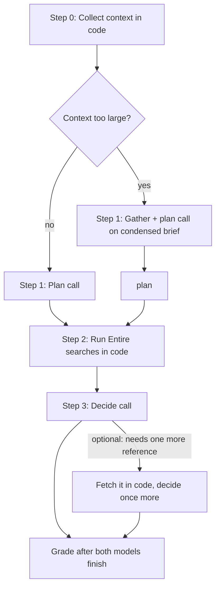

# Brief: issue-to-files prediction pipeline (v2)

Hand this whole document to the implementing model. It describes what to build, the rules it must not break, and how to verify it.

## Goal

Given a **closed GitHub issue** and a **pre-merge fork** of its repository indexed in Entire, predict which **existing files** the fixing PR modifies. Grade against the PR's modified existing files.

Target: mean recall around **0.75** across the five benchmark cases, with precision staying reasonable (above ~0.6). Do it with **as few model calls as possible**: the code does the fetching and searching, and models only think.

## Where things are

- Working folder: `/Users/bhavya/Downloads/idea`
- Existing script to extend: `entire_compare.py`. It reuses `github`, `score`, `SCHEMA` and `FilePrediction` from `issue_surface.py`.
- Benchmark manifest (5 cases): `/Users/bhavya/.ao/data/artifacts/idea-2/entire-file-finding-manifest.json`. Each entry has `issue_url`, `pr_url`, `fork`, `pre_merge_sha`, `modified_existing_files`.
- Previous results to compare against: `entire-file-finding-results.json`. Baseline mean recall was 0.44 for Claude and 0.54 for OpenAI, with mean precision of 0.90 and 0.83.
- Keys come from `.env`: `NEATLOGS_API_KEY`, `ANTHROPIC_API_KEY`, `OPENAI_API_KEY`. Never print or commit them.
- Run with: `uv run --python 3.13 --with neatlogs --with claude-agent-sdk --with openai-agents --with anthropic entire_compare.py ...`

## Hard rules

1. **No answer leakage.** The fixing PR's URL, number, title, body, comments, diff and file list must never reach any model before both models have submitted. This includes indirect leaks:
   - Skip any reference to the target PR number in the issue thread. The requests case (#6586) has comments that mention the fixing PR #6589.
   - **Time cutoff:** include only issue comments, referenced issues and referenced PRs **created before the target PR's `created_at`**. Drop anything later.
   - The grading data (PR files and ground truth) is fetched only after both predictions are in.
2. Don't modify the forks or their Entire mirrors. Read-only search only.
3. Don't use the Codex CLI.
4. Use the same models and settings for every case: Claude **Sonnet** (`sonnet`) and OpenAI **`gpt-6-sol`**, both on **medium** reasoning. Run the two models **in parallel**, each through the whole pipeline on its own.
5. Every run must be traced in **Neatlogs**: one WORKFLOW trace per case, with a span for each step below, and record the trace ID in the results.
6. Don't add tests or a README.

## Pipeline (per case, per model)



### Step 0: Collect context (code, no model)

Build a context bundle from the GitHub API.

- **Issue:** title, body, and every comment created before the cutoff.
- **References found in the issue text and comments** (`#123`, full GitHub URLs, `owner/repo#123`):
  - **Referenced issue:** title, body, and comments created before the cutoff.
  - **Referenced PR** (never the target PR, and only if created before the cutoff): **title and the author's description only.** No diff, no file list, no review comments. Add a one-line pointer such as `PR #1234: N comments, N files changed (not included)` so the model knows more exists.
  - Follow references **one level deep only**.
- **File paths and tracebacks mentioned in the text:** extract the paths as hints. Don't fetch file contents.
- **Repository map:** from the pre-merge commit tree (`git/trees/{pre_merge_sha}?recursive=1`), include the top-level entries plus a compact list of directories. Mark files that exist with conventional names, such as `CHANGES*`, `CHANGELOG*`, `docs/`, `doc/`, `tests/`, `test/`, `testing/` and `pyproject.toml`.
- Strip boilerplate such as "System Information" blocks and issue templates.

GitHub's unauthenticated API allows 60 requests per hour. Use a `GITHUB_TOKEN` if one is available, cache responses on disk per case, and fetch only once even though both models use the bundle.

### Step 1: Plan (1 model call, no tools)

The model reads the bundle the way a maintainer would and returns structured JSON:

```json
{
  "problem": "one or two sentences",
  "suspected_cause": "where and why",
  "search_terms": ["6-10 literal identifiers or phrases, with alternatives"],
  "expected_file_kinds": ["fix", "tests", "changelog", "docs", "config"]
}
```

**When the context is too large (the intermediate agent):** if the bundle is over about **8k tokens**, use this step to condense it as well as plan. It also outputs a `brief` field: an *extractive* summary of exact quotes, identifiers, error messages, paths, and what each referenced item was about. Don't add a separate model call just for gathering. A separate cheap gatherer (Haiku or `gpt-6-luna`) is only worth it if bundles regularly exceed the decide model's comfortable context. The gatherer must follow the same leakage rules, because it never sees the target PR either.

### Step 2: Search (code, no model)

- Run every `search_terms` entry with `entire search --code "<term>" --repo gh/<fork> --json --limit 30`, **in parallel**.
- **Group hits by file:** path, hit count, which terms matched, and the best 2 matching lines per file.
- Also list the files that match the plan's `expected_file_kinds` from the repository map, such as the changelog file, the docs folder, and test files whose names match the modules that were hit (for example `src/flask/sansio/app.py` → `tests/test_*.py` files that import or mention it).
- Cap the output at about 40 files and order it by relevance.

### Step 3: Decide (1 model call, no tools)

Input: the issue bundle (or `brief`), the plan, and the grouped search results. Output a **category schema** in place of a flat list, so the model has to consider each kind of file:

```json
{
  "fix": ["paths"],
  "tests": ["paths"],
  "changelog": ["paths"],
  "docs": ["paths"],
  "config": ["paths"],
  "need_more": null
}
```

- Every category may be empty, but the model must think about each one.
- Paths must exist in the pre-merge tree. Validate this in code and drop paths that don't exist, but record them.
- Instruct the model to include every file a maintainer would touch in this PR, not the smallest set.
- **`need_more` (optional, at most once):** a referenced item, for example `"#1234 comments"` or `"#1234 files"`. The code fetches it only if it isn't the target PR and was created before the cutoff, then reruns Step 3 once with the extra data. Most cases should need 2 model calls, and never more than 3.

The final prediction is the union of all categories.

## Implementation notes

- **Claude:** use the plain Anthropic API (`anthropic` package, Neatlogs auto-instrumented) for these tool-free calls rather than the Claude Agent SDK. The SDK adds a large system prompt per run (about 2.8k cache-write tokens). Use structured output or JSON mode for the schemas.
- **OpenAI:** use the Agents SDK with no tools or the Responses API, `gpt-6-sol`, medium reasoning. Raise `max_tokens` from 1000 to at least 4000 so reasoning doesn't cut the output short.
- Keep a single prompt template for both models. No repo-specific hints in the prompts: they must still generalize to new issues.
- Keep the old agent mode available so results can be compared.

## Scoring and results

After both models submit, fetch the PR's modified existing files and compare. Write **one compact results file**, `entire-file-finding-results-v2.json`, with:

- `settings`: models, effort, `max_tokens`, cutoff rule, context-size threshold.
- Per case: issue, PR, fork, pre-merge SHA, Neatlogs trace ID, wall time, true paths, and for each model:
  - predicted paths (both by category and as the union), missed, extra, dropped nonexistent paths
  - precision, recall, exact match
  - number of model calls, whether `need_more` was used, and whether the condensing path triggered
  - tokens: input, cached, cache write, output, reasoning, total
  - **cost:** `recorded_cost_usd` only where a provider or SDK reports it, otherwise `estimated_cost_usd` from list prices, with the price table written into the file
- A `summary` per model, plus a list of **missed files per model**.

List prices for estimates: gpt-6-sol is $2/M input, $0.20/M cached input, $2.50/M cache writes and $10/M output. Claude Sonnet uses Anthropic's current list prices. Write both price tables into the results file.

## Run plan (credits are limited)

1. **Dry run (free):** build the Step 0 bundle for all five cases and print exactly what each model would see. Check by hand that no target PR number, title or body appears anywhere, and that the requests case has #6589 removed.
2. **One case:** run the pytest case (#1764, 8 true files, the hardest). Check the Neatlogs trace: plan quality, search terms, grouped results and the cost.
3. **All five:** only after step 2 looks right.

## Done when

- All five cases ran with both models in parallel, each case has a Neatlogs trace ID, and the results file is written.
- The dry-run output shows no leakage.
- The summary is compared against the baseline (recall 0.44 and 0.54).
